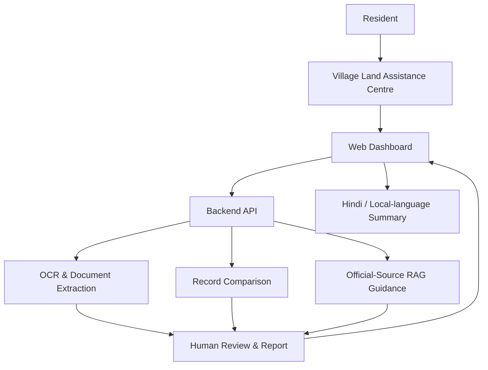

# BhoomiSaarthi
### Agentic AI for Rural Land Record Intelligence
**Making Land Records Clear, Accessible & Actionable**

> Hackathon prototype concept: a human-assisted AI platform that helps rural families understand land documents and navigate land-record workflows through trained local operators.

## Problem
Land records can be difficult to interpret, inconsistent across documents, and hard to navigate—especially for rural families dealing with inheritance, mutation, or bank documentation.

## Proposed Solution
BhoomiSaarthi combines document intelligence and guided workflows with Village Land Assistance Centres. Trained local operators help residents upload records, review AI-generated explanations, and receive clear next-step checklists in Hindi or a supported local language.

## Planned / Prototype Features
- **Land document reader:** OCR and extraction of fields such as owner name, survey/khasra number, area, dates, and record identifiers.
- **Cross-document comparison:** flag possible differences in names, survey numbers, or land area for human review.
- **Mutation & inheritance guidance:** state-specific checklists grounded in official sources.
- **Plain-language reports:** explain extracted information and potential issues in accessible language.
- **Assisted service-centre workflow:** operator dashboard and case tracking.
- **Responsible AI:** uncertainty indicators, human review, privacy safeguards, and clear limitations.

> **Important limitation:** BhoomiSaarthi is an informational assistance tool. It does not certify legal ownership, resolve disputes, approve mutations, or guarantee loan eligibility/valuation. Final decisions remain with competent authorities and financial institutions.

## Rural Access & Employment Model
Each Village Land Assistance Centre may be operated by 2–3 trained local members (proposed model). This reduces the need for residents to own smartphones or independently use AI and can create local digital-service opportunities. The model should be validated with communities and local partners.

## Proposed User Journey
1. A resident visits a local assistance centre.
2. The operator uploads available land documents with consent.
3. The system extracts key fields and compares records.
4. Possible discrepancies are highlighted with confidence/uncertainty notes.
5. The operator reviews the output with the resident.
6. The system provides a source-backed checklist and a printable/shareable summary.
7. The operator tracks the case status and follow-up.

## Architecture (Proposed)


## Suggested Tech Stack
- Frontend: React / Next.js
- Backend: Python + FastAPI
- AI orchestration: LangGraph or a controlled workflow orchestrator
- OCR: PaddleOCR / Tesseract (evaluate on actual document samples)
- Database: PostgreSQL
- Retrieval: pgvector or another vector store (only for verified official sources)
- Deployment: choose a suitable hosting provider for the prototype

## Repository Structure
```text
BhoomiSaarthi/
├── frontend/                 # Web dashboard (planned/under development)
├── backend/                  # API services
├── ai/                       # Extraction, comparison, guidance workflows
├── docs/
│   ├── architecture.md
│   └── demo-script.md
├── sample-data/               # Synthetic/demo records only; no real personal data
├── .gitignore
└── README.md
```

## Demo Script (Suggested)
Use **synthetic sample documents**:
- Show a sample record with a fictional name and survey number.
- Upload two synthetic records.
- Demonstrate extraction and a possible mismatch flag.
- Show a source-backed mutation checklist.
- Explain how a trained operator reviews and communicates the result.

## Privacy & Safety
- Obtain informed consent before processing documents.
- Do not upload real residents' records to a public repository.
- Use synthetic or redacted samples in demos.
- Restrict access to uploaded files and define a deletion/retention policy.
- Treat OCR/AI outputs as suggestions requiring human review.
- Cite official sources for procedural guidance and show the relevant state/jurisdiction.

## Project Status
- [ ] Concept and problem definition
- [ ] UI prototype
- [ ] OCR extraction
- [ ] Record comparison
- [ ] Official-source guidance
- [ ] Operator workflow
- [ ] Demo deployment

Update this checklist honestly as features are implemented.

## Team
Add team members and roles here.

## License
Choose a license before making the repository open source (for example, MIT if appropriate).
